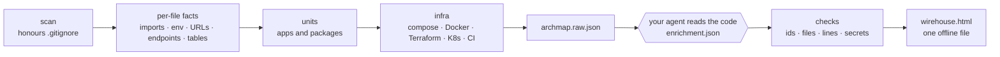

<p align="center">
  <picture>
    <source media="(prefers-color-scheme: dark)" srcset="https://raw.githubusercontent.com/creyes-git/wirehouse/main/docs/brand/readme/readme-banner-dark.svg">
    
  </picture>
</p>

<p align="center">
  <b>See how your codebase really fits together, and prove it.</b><br>
  Wirehouse maps a repository from its code and turns it into a 3D warehouse you can walk:
  services are shipping containers, databases are silos, auth is a security gate, and every pipe is
  a connection found in the code, with the file and line that prove it. Trace where a request goes,
  take a guided tour, and share it all as <b>one offline HTML file</b>.
</p>

<p align="center">
  <a href="https://github.com/creyes-git/wirehouse/actions/workflows/ci.yml"></a>
  
  <a href="https://github.com/creyes-git/wirehouse/blob/main/LICENSE"></a>
  
  
</p>

<p align="center">
  <a href="https://creyes-git.github.io/wirehouse/demo/"><b>Try the live demo</b></a> ·
  <a href="#quick-start"><b>Quick start</b></a> ·
  <a href="#why-wirehouse"><b>Why Wirehouse</b></a> ·
  <a href="#how-to-use"><b>How to use</b></a> ·
  <a href="#how-it-works"><b>How it works</b></a>
</p>

<p align="center">
  <a href="https://creyes-git.github.io/wirehouse/demo/"></a>
  <br>
  <sub>The warehouse of <a href="https://github.com/fastapi/full-stack-fastapi-template">fastapi/full-stack-fastapi-template</a>, described by a coding agent.
  <a href="https://creyes-git.github.io/wirehouse/demo/">Open it yourself</a> (one 1.2 MB HTML file) ·
  <a href="https://github.com/creyes-git/wirehouse/blob/main/docs/assets/demo.mp4">MP4</a></sub>
</p>


## Why Wirehouse

Architecture diagrams go stale the day they are drawn, and reading a new codebase file by file tells
you *what* is there but not *how it fits together*. Wirehouse rebuilds the map from the code every
time, and holds it to one rule: **nothing is drawn that the code does not show.**

- **A map you can check.** Every connection found in the code carries the file and line it was found
  at, linked to your code host at the exact commit that was scanned. What an agent adds must cite real code or it
  is left out, inferred links say so, and a **Checks** panel lists anything that was dropped and why.
- **Current in seconds, not a drawing to maintain.** Re-run it after a change; descriptions are
  cached by a hash of the code, so only what changed is described again. `--against` shows exactly
  which blocks, connections and files a change touched.
- **One file, nothing to host.** The page is a single offline HTML file with everything inlined:
  no server, no account, no telemetry, no network loads. Email it, attach it to a pull request, or
  publish it on GitHub Pages.
- **Answers real questions.** *What does this service reach?* Trace it, with hop counts.
  *How does a request get to the database?* Walk the route stop by stop. *Where do I start?* Take
  the tour, then go find things with quests.
- **Your agent, or no agent.** The `/wirehouse` skill uses the open `SKILL.md` format and works with
  Claude Code, Codex, Cursor, OpenCode, Gemini CLI, GitHub Copilot and any agent that reads files. Without
  one, the CLI still draws the full map with rule-based descriptions.
- **Safe to share.** Real `.env` files are never read, credential-looking text is cut from every
  output, and `--share` removes your local paths before you publish.

<p align="center">
  
  <br>
  <sub>The same map as text for your agent or your pull request (<code>wirehouse export</code>), and as a place to walk.</sub>
</p>

### How it compares

| | Hand-drawn diagram | Mermaid in the docs | Wirehouse |
|---|:---:|:---:|:---:|
| Built from the code | no | no | **yes** |
| File and line behind each connection | no | no | **yes** |
| Stays current without redrawing | no | no | **yes** |
| Follows env vars, compose, Terraform and CI, not just imports | by hand | by hand | **yes** |
| Shows what a change touched | no | in the diff | **yes** (`--against`) |
| Guided tours and traces for newcomers | no | no | **yes** |
| Text for a README or pull request | no | yes | **yes** (`wirehouse export`) |

## What you can do

<table>
<tr>
<td width="50%"><br><b>Trace</b> everything a block leads to, or everything that leads to it, with hop counts. File precise.</td>
<td width="50%"><br><b>Walk a route</b> from A to B, hop by hop, with the code behind each step.</td>
</tr>
<tr>
<td><br><b>Guided tours and quests</b> written by your agent from the real code, stop by stop with file and line.</td>
<td><br><b>Walk into any block.</b> Folders are crates, files sit on racks with aisle signs, connections leave through wall ports.</td>
</tr>
<tr>
<td><br><b>Database rooms</b> with columns, keys and a schema diagram.</td>
<td><br><b>Floor plan</b> in 2D for a quick overview, fully keyboard accessible.</td>
</tr>
<tr>
<td><br><b>The Clipboard</b>: a first-shift checklist, tours, quests and what you have inspected so far.</td>
<td><br><b>Night and day shift</b> lighting; the page adapts its resolution to keep slower laptops responsive.</td>
</tr>
</table>

Also: search that walks you to anything, links that reopen the exact view, commit-pinned links to
GitHub, GitLab, Bitbucket and Azure DevOps, pictures or 1200 × 630 share cards of what you are looking
at, and optional sound.

## Quick start

Requires Python 3.11+.

```bash
pip install "git+https://github.com/creyes-git/wirehouse"
wirehouse install          # adds the wirehouse skill to the coding agents on this machine
```

Then, in your coding agent, inside any project:

```text
/wirehouse
```

(Or just ask: *"map this project with wirehouse"*.) The agent scans the project, reads the code to
describe every block and connection, writes tours and quests, and opens
`wirehouse-out/wirehouse.html`.

### Works with your agent

Wirehouse ships as a skill in the open `SKILL.md` format. `wirehouse install` writes it to the
shared `~/.agents/skills` folder and to the skills folder of every agent it finds in your home
folder:

| Agent | Skill folder |
|-------|--------------|
| Codex and other agents that read the shared folder | `~/.agents/skills` (written unless you pick `--agent` or `--dir`) |
| Claude Code | `~/.claude/skills` |
| Cursor | `~/.cursor/skills` |
| OpenCode | `~/.config/opencode/skills` |
| Gemini CLI | `~/.gemini/skills` |
| Antigravity | `~/.gemini/antigravity/skills` |
| GitHub Copilot | `~/.copilot/skills` |

Pick agents with `wirehouse install --agent cursor --agent opencode`, add any other skills folder
with `--dir <folder>`, or run `wirehouse install --print` and paste the instructions into an agent
that has no skills support. Restart the agent if it was already open.

**No agent?** The CLI draws the same map with rule-based descriptions and a starter tour:

```bash
wirehouse build path/to/project --open
```

## How to use

### 1. Make a map

| Command | What it does |
|---------|--------------|
| `/wirehouse [path]` | In your agent: scan, describe, render and open. Add `--quick` to skip the descriptions. |
| `wirehouse build <path> [--open]` | Scan and render in one go, reusing any descriptions from earlier runs. |
| `wirehouse scan <path>` | Detect structure only: writes `archmap.raw.json` and the agent's worklist `enrich-brief.md`. |
| `wirehouse render <path> [--open]` | Merge `enrichment.json` and write `wirehouse.html`. |
| `--share` | (build, render) Leave out local paths before you publish the page. |
| `--strict` | (build, render) Exit with an error when the checks left parts of the enrichment out, for CI. |
| `--against <map>` | (build, render) Compare with an earlier `archmap.json`: the page and the export show what changed. |
| `-o <folder>` | Write somewhere other than `<path>/wirehouse-out/`. |
| `wirehouse export <path>` | Write `architecture.md`: a Mermaid diagram, the blocks and every connection with its file and line. `--format mermaid` writes only the diagram (`architecture.mmd`). |
| `wirehouse install` | Add the skill to your agents (`--agent`, `--dir`, `--print`; see above). |

Descriptions are cached by a hash of the code they describe, so re-running `/wirehouse` after a
change only asks the agent about what changed. Add `wirehouse-out/` to your `.gitignore`.

### 2. Walk around

<picture>
  <source media="(prefers-color-scheme: dark)" srcset="https://raw.githubusercontent.com/creyes-git/wirehouse/main/docs/brand/readme/readme-how-it-maps-dark.svg">
  
</picture>

The floor is laid out from the entrance to the back: **Clients**, **Gateway and auth** (shown even
when empty, because "no auth found" is worth knowing), **Services**, **Data**, and the
**Loading dock** for third-party providers. **Ops** (CI/CD, Terraform, Kubernetes, hosting,
observability) runs down the left side.

| Do this | To |
|---------|----|
| `W` `A` `S` `D` / arrows (`Shift` to run, `Space` to jump) | walk the worker around |
| Drag, scroll | look around, zoom |
| Click a block, rack item or pipe | open its inventory tag: description, code locations, endpoints, connections |
| Click it again, or the floor, or the minimap | walk there |
| `E` / `Q` | walk into the block in front of you / step back out |
| `/` | search everything and walk straight to it |
| `P` | switch between walking and the 2D floor plan |
| `T` | switch between night shift and day shift |
| `R` | route from the inspected block: pick an end point and walk it |
| `C` | the Clipboard: tours and quests |
| `X` | export a picture or a share card |
| `V` | changes since an earlier map, when the page has them |
| `Space` `,` `.` | during a tour or route: play or pause, back, next |
| `Esc` | back out one step: close, pause, stop, clear |
| `?` | show the controls |

Pipe colors: calls (blue), reads and writes (amber), sign-in (pink), messages (red), code imports
(grey), provisioning (green), foreign keys (tan). The **pipe key** in the bottom-left corner is
also a filter: switch a kind off to hide it everywhere, traces included. Switching off imports
gives you runtime-only reach.

### 3. Trace and route

Inspect a block and press **Downstream** (where it leads) or **Upstream** (what leads to it).
Rings and badges mark every place it reaches, with the number of hops, and the trace bar lists
them so you can jump to any of them.

- Traces follow **recorded connections only**: what the scanner found plus what your agent added
  with evidence. That is the map's reach, not a promise about runtime impact. Start-up order
  (`depends_on`) and provisioning are left out, because they are not traffic.
- They are **file precise**: a trace from `web/lib/payments.ts` follows that file's connections,
  not the whole frontend's. A connection that points at a whole block (an env var naming a
  service) reaches everything inside it.
- **Hops count block boundaries**, so a chain of imports inside one service does not make
  something look further away.

Press **R** (or *Route to…*) and pick an end point: Wirehouse finds the shortest recorded path and
the worker walks it stop by stop, showing the file and line behind each hop. If the blocks connect
but the files do not line up, the route says it is **loose**.

### 4. Tours and quests

Open the **Clipboard** (`C`). **Tours** walk the worker through the system in the order things
really happen ("What happens when you log in"). **Quests** send you looking ("Where are passwords
hashed?") and tick off when you inspect the answer. Progress stays in your browser.

Your agent writes them during `/wirehouse`. You can add your own to
`wirehouse-out/enrichment.json`:

```json
{
  "tours": [
    {"id": "login", "title": "What happens when you log in", "stops": [
      {"node": "unit:js:frontend", "text": "The login form posts the email and password.",
       "evidence": [{"file": "frontend/src/routes/login.tsx", "line": 42}]}
    ]},
    {"id": "request", "title": "Follow a request to the database", "route": ["actor:users", "res:postgres"]}
  ],
  "quests": [
    {"question": "Where are passwords hashed?", "answer": ["file:backend/app/core/security.py"],
     "hint": "Look in the backend's core folder.", "explain": "...",
     "evidence": [{"file": "backend/app/core/security.py", "line": 20}]}
  ]
}
```

`wirehouse render` checks every node id, file and line, and prints one line per problem:

```text
error [evidence/line-out-of-range] tours[login].stops[0]: `frontend/src/routes/login.tsx` has 30 lines, cited line 42 -> open the file and cite the line the claim is based on
```

Invalid parts are left out of the page, never guessed, and the page's **Checks** button lists what was
left out and why, so a reader knows it is missing rather than never written. Without enrichment, Wirehouse makes a
main-floor tour, a follow-a-request route and a few quests from what it found.

### 5. Database rooms

Walk into a database to see its tables on racks, with foreign keys as pipes between them. The
inventory tag lists each table's columns and keys, and **Open schema diagram** draws them all.
Columns are read from SQL migrations, Prisma, SQLAlchemy, SQLModel, Django, Drizzle and TypeORM.

### 6. Review a change

Keep a copy of `wirehouse-out/archmap.json` from before a change (for example from `main`), then build
with `--against` it:

```bash
wirehouse build . --against ../main-map/archmap.json
```

**Changes** (`V`) lists the blocks, connections and files that are new, changed or removed, and
**Show on the floor** badges them in every room and lights the new pipes. A block counts as changed only
when the code inside it did. Removed things are listed, not drawn: they are no longer in the code.
`wirehouse export` adds the same list to `architecture.md`.

### 7. Share it

- The address bar always describes the view (`#room=`, `#focus=`, `#trace=down~<id>`,
  `#route=<from>~<to>&stop=2`, `#tour=<id>&stop=3`, `#plan=1`), and **Copy link** copies it.
- Code links go to your code host **at the exact commit that was scanned**, so they keep working
  when the file is shared. Files with uncommitted changes are marked.
- **Export** (`X`) saves or copies a picture of the view, or a 1200 × 630 share card describing the
  route, trace or tour on screen.
- The page is a single file with everything inlined. Email it, attach it to a pull request, or
  host it anywhere static. Use `--share` so it does not include your local folder paths.

## How it works



1. **Scan** walks the repo, honours `.gitignore`, skips build output and dependency folders, and
   never opens real `.env` files (templates like `.env.example` are fine).
2. **Detectors** find imports, env var reads, URLs, HTTP endpoints (FastAPI, Flask, Django, Express,
   NestJS, Next.js, ASP.NET, Go routers), tables and columns, apps and packages, and infrastructure.
3. **Build** maps about 115 technology signatures to blocks. Env values wire things together:
   `API_URL=http://api:8000` links the code that reads it to the `api` service, and
   `DATABASE_URL=postgresql://...@db/...` links it to the Postgres container. Connections are kept
   at file level and rolled up to whatever level you are looking at.
4. **Enrichment**: your agent reads the code and writes descriptions, connection notes, corrections
   (each with file:line evidence), tours and quests. Entries carry a content hash, so later runs only
   ask about code that changed.
5. **Checks**: every citation is verified against the scan, and secret-looking text is removed.
6. **Render** inlines Three.js, the fonts, the data and the app into one HTML file of about 1 MB.

| Output in `wirehouse-out/` | What it is |
|------|------------|
| `archmap.raw.json` | What the rules found |
| `enrich-brief.md` | The agent's worklist |
| `enrichment.json` | Descriptions, corrections, tours and quests, kept between runs |
| `archmap.json` | The merged data behind the page |
| `wirehouse.html` | The warehouse |
| `architecture.md` / `.mmd` | The map as text, from `wirehouse export` |

## What it detects

- **JavaScript / TypeScript**: Next.js, React, Vue, Svelte, Nuxt, Remix, Astro, Angular, Express,
  Fastify, NestJS, Hono, Electron, React Native; tsconfig path aliases.
- **Python**: FastAPI, Flask, Django, Starlette, Litestar, Celery, RQ, Streamlit and more.
- **.NET**: ASP.NET Core, Worker services, Azure Functions, Blazor, WPF, MAUI; EF Core and
  connection strings.
- **Go**: modules from `go.mod`, Gin, Echo, chi, Fiber, gorilla/mux, gRPC, `net/http` (including Go 1.22
  `"GET /path"` patterns), cobra CLIs; GORM and ent; drivers and SDKs for the databases, queues and
  providers below.
- **Data**: Postgres, MySQL, SQL Server, SQLite, MongoDB, Redis, queues, object storage and search,
  with tables and columns from SQL, Prisma, SQLAlchemy, SQLModel, Django, Drizzle and TypeORM.
- **Infra**: docker-compose (including override files), Dockerfiles, Terraform (AWS, Azure, GCP),
  Kubernetes, GitHub Actions and other CI, Nginx, Caddy, Traefik, Vercel, Netlify, Fly.
- **Third parties**: Stripe, Clerk, Auth0, Supabase, Firebase, OpenAI, Anthropic, Sentry and about
  a hundred more.

Missing your stack? [Tell us where the map is wrong](https://github.com/creyes-git/wirehouse/issues/new?template=wrong_map.yml).

## Privacy and safety

- Runs locally. No network requests, no telemetry, and the page loads nothing from the network.
- Never reads real `.env` files. Env values, passwords, connection strings, column defaults and
  credentials inside git remotes are never written to the output.
- Text written by the agent is checked for credential-looking strings, which are removed.
- Scanning a repository you did not write is safe: the scan never follows links out of the project,
  never runs commands named by the repository's own git config, and an `enrichment.json` that came
  with the repository is applied only with a warning, with every block or connection it removes
  listed under **Checks**.

See [SECURITY.md](https://github.com/creyes-git/wirehouse/blob/main/SECURITY.md) to report a problem.

## Limits

- Detection is regex based. It favours precision over recall: it would rather miss a connection
  than draw a wrong one, and the agent's pass adds what it misses (with evidence).
- Wiring that only exists at runtime (service discovery, URLs built on the fly, DI containers) is
  found only when it shows up in env vars, config or literals, so traces cannot see it either.
- Very large rooms (hundreds of files in one folder) render fine but get dense; search is the
  fastest way around.
- The page needs WebGL for the 3D view; the floor plan works without it.

## Roadmap

- **Change review from git**: `--against main` that scans the other branch itself, without a saved map.
- **History**: a timeline of how each block changed, from git.
- More stacks: Java/Kotlin (Spring), Ruby on Rails, PHP (Laravel).
- Bigger repos: instanced rendering for rooms with thousands of files.

Ideas welcome in [Discussions](https://github.com/creyes-git/wirehouse/discussions).

## Contributing

Contributions are welcome, and the most useful one is a project where the map is wrong. See
[CONTRIBUTING.md](https://github.com/creyes-git/wirehouse/blob/main/CONTRIBUTING.md) for setup, the ground rules and where things live, and please
follow the [Code of Conduct](https://github.com/creyes-git/wirehouse/blob/main/CODE_OF_CONDUCT.md).

```bash
pip install -e ".[dev]" && python -m pytest
```

## Acknowledgements

- [Three.js](https://threejs.org) (MIT) renders the warehouse, and the
  [Barlow](https://github.com/jpt/barlow) typeface (SIL Open Font License) labels it. Both are
  vendored in `wirehouse/render/vendor/` with their licenses.
- Trace, route, links-into-a-view and evidence-first validation were inspired by
  [Archify](https://github.com/tt-a1i/archify) (MIT) and its "truth before spectacle" principle.
- The demo maps [fastapi/full-stack-fastapi-template](https://github.com/fastapi/full-stack-fastapi-template) (MIT).

## License

[MIT](https://github.com/creyes-git/wirehouse/blob/main/LICENSE) © Carlos Reyes
